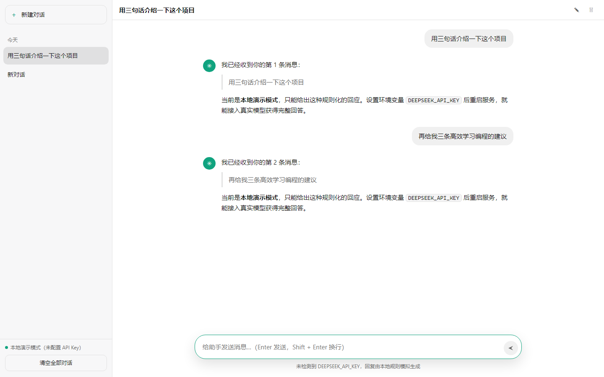

# hello-dsh

一个**类似 ChatGPT 的网页聊天应用**，零第三方依赖，只用 Node.js 内置模块实现。
它同时是 [DeepSeek Harness](https://github.com/deepseek-ai/deepseek-harness)（`dsh`）的
练手项目：代码量小到可以一次读完，但结构完整（领域模型 / 持久化 / HTTP / 前端 / 测试分层）。

> 🔗 **在线演示（GitHub Pages）**：<https://kevinzhang19870314.github.io/hello-dsh/>
>
> 纯前端版本：`fetch` 被 `site/local-api.js` 接管，对话存在浏览器 `localStorage`，
> 回复来自与本地 `npm start`（未配置 API Key 时）**完全相同**的规则引擎。
> 想接真实模型请在本地运行，见下方「配置 API Key」。

## 功能

- 💬 **ChatGPT 风格界面**：左侧会话列表 + 右侧对话流，深色 / 浅色自动适配，移动端可用。
- ➕ **新增对话**：点「新建对话」立刻开启一段新会话；标题在第一条消息后自动生成。
- 🗑 **删除对话**：鼠标悬停在会话上点垃圾桶图标即可删除，也可以删除当前对话或一键清空全部。
- ✎ **重命名对话**：顶部 ✎ 就地编辑标题。
- ⚡ **流式回复**：助手回复通过 SSE 逐字返回，带打字机效果。
- 💾 **本地持久化**：所有会话写入 `data/conversations.json`，重启后仍在。
- 🤖 **两种回复模式**：
  - 配置了 `DEEPSEEK_API_KEY`：调用 DeepSeek Chat Completions 流式接口；
  - 未配置：使用内置离线规则回复，界面与接口完全可用（也便于测试）。



## 快速开始

```sh
npm start          # http://127.0.0.1:3210
npm test           # node:test 单元 + 集成测试
```

打开浏览器访问 <http://127.0.0.1:3210>，即可开始聊天。

### 配置 API Key（.env）

项目根目录的 `.env` 会在启动时自动读取，直接填入即可：

```ini
DEEPSEEK_API_KEY=sk-...
```

没有这个文件时，复制模板再改：

```sh
cp .env.example .env      # Windows: copy .env.example .env
```

`.env` 支持 `KEY=VALUE`、`#` 注释、单/双引号（双引号内可用 `\n`），并且**已被 `.gitignore` 忽略**，不会提交到仓库。也可以临时用 shell 变量，或指向别的文件：

```sh
# 临时（优先级高于 .env）
DEEPSEEK_API_KEY=sk-... npm start
node src/index.js --env ./config/prod.env
```

加载了哪些变量会打印在启动日志里：

```
hello-dsh 聊天服务已启动
  地址      http://127.0.0.1:3210
  数据文件  E:\work\github-projects\hello-dsh\data\conversations.json
  回复模式  DeepSeek API
  配置文件  E:\work\github-projects\hello-dsh\.env（载入 1 项）
```

## 目录结构

| 路径 | 作用 |
|---|---|
| `src/chat-store.js` | 会话 / 消息领域模型（新建、重命名、删除、追加消息、摘要），无 I/O |
| `src/text-utils.js` | 纯文本工具（截断、标题生成、分块），Node 与浏览器共用 |
| `src/local-replies.js` | 离线规则回复引擎，Node 与浏览器共用（无 Node API） |
| `src/storage.js` | JSON 持久化与数据文件路径解析（`CHAT_DATA` 覆盖） |
| `src/assistant.js` | 回复生成：DeepSeek 流式 API + 离线规则回复 |
| `src/server.js` | HTTP 服务：REST 接口、SSE 流式回复、静态资源 |
| `src/index.js` | 启动入口（`.env` 加载、`--port` / `--host` / `--env` 参数） |
| `src/env.js` | 零依赖 `.env` 解析与加载（shell 中已存在的变量优先） |
| `public/` | 前端：`index.html`、`styles.css`、`app.js`（原生 ES Module，无构建步骤） |
| `test/` | `node:test` 测试：领域模型、持久化、HTTP 接口、静态版接口垫片 |
| `site/` | 只在静态构建里使用的文件：`local-api.js`（浏览器版后端）、`boot.js`（入口） |
| `scripts/build-pages.js` | 生成 `docs/` 静态站点（`npm run build:pages`） |
| `docs/` | **生成的** GitHub Pages 站点；`screenshot.png` 是 README 截图，构建不会动它 |

数据文件默认是 `data/conversations.json`（已被 `.gitignore` 忽略，首次写入时自动创建）。

## HTTP 接口

| 方法 | 路径 | 说明 |
|---|---|---|
| `GET` | `/api/health` | 服务状态、回复模式、数据文件路径 |
| `GET` | `/api/conversations` | 会话摘要列表（按更新时间倒序） |
| `POST` | `/api/conversations` | 新建会话，body 可带 `{ "title": "..." }` |
| `DELETE` | `/api/conversations` | 清空全部会话 |
| `GET` | `/api/conversations/:id` | 读取单个会话及其消息 |
| `PATCH` | `/api/conversations/:id` | 重命名，body `{ "title": "..." }` |
| `DELETE` | `/api/conversations/:id` | 删除单个会话 |
| `POST` | `/api/conversations/:id/messages` | 追加消息并生成回复；`{"content":"...","stream":false}` 返回 JSON，默认返回 SSE |

SSE 事件帧：`start` → 若干 `delta` → `done`（或 `error`），例如：

```
data: {"type":"delta","text":"你好"}
data: {"type":"done","assistantMessage":{...},"conversation":{...}}
```

## 环境变量

启动时会先加载项目根目录的 `.env`（可用 `--env <path>` 换路径）；**shell 中已存在且非空的变量优先**，所以临时覆盖很方便：`DEEPSEEK_API_KEY=... npm start`。

| 变量 | 默认值 | 说明 |
|---|---|---|
| `.env` | — | 项目根目录的配置文件，启动时自动读取（已 gitignore） |
| `PORT` / `HOST` | `3210` / `127.0.0.1` | 监听地址，也可用 `--port` / `--host` |
| `CHAT_DATA` | `<项目>/data/conversations.json` | 会话数据文件路径 |
| `DEEPSEEK_API_KEY` | — | 配置后启用真实模型回复 |
| `DEEPSEEK_MODEL` | `deepseek-chat` | 模型名 |
| `DEEPSEEK_BASE_URL` | `https://api.deepseek.com` | 接口地址（可指向兼容服务） |
| `CHAT_SYSTEM_PROMPT` | 内置中文提示词 | 系统提示词 |
| `CHAT_STREAM_DELAY_MS` | `12` | 离线模式的逐字延迟（测试里设为 `0`） |

## 部署到 GitHub Pages

GitHub Pages 只能托管静态文件，而本项目自带 Node 服务端，所以静态版换了一个「后端」实现：

```sh
npm run build:pages     # 生成 docs/
```

- `public/app.js` **一行都不用改**：它照旧请求 `/api/...`，但 `site/local-api.js` 在
  `window.fetch` 上装了一层垫片，把这些请求就地应答——数据存 `localStorage`，
  回复走 `src/local-replies.js`，SSE 帧格式（`start` → `delta`* → `done`）与
  `src/server.js` 完全一致。
- `src/text-utils.js` 和 `src/local-replies.js` 不依赖任何 Node API，构建时原样复制进
  `docs/`，所以线上演示与本地 `npm start`（无 API Key 时）的回复逐字相同。
- 构建脚本会断言 `public/index.html` 里需要改成相对路径的地方（项目站点发布在
  `/<repo>/` 子路径下），改坏了会直接报错而不是默默发布一个坏站点。
- `npm test` 中有 13 个用例直接跑在 `docs/local-api.js`——也就是真正被部署的那个文件上，
  并且会在 `docs/` 与源码不同步时失败，所以改完源码记得重新 `npm run build:pages`。

线上地址：<https://kevinzhang19870314.github.io/hello-dsh/>
（Pages 发布源为 `main` 分支的 `/docs` 目录。）

## 用 dsh 继续开发

在本目录启动 Web UI，把该目录选为 workspace，然后可以让 agent 做这些事：

- `给会话列表加上搜索框，并在服务端支持 ?q= 过滤。`
- `给每条助手消息加上“复制 / 重新生成”按钮。`
- `用 SSE 之外再提供一个 WebSocket 通道，并补上测试。`
- `运行 npm test，修复所有失败用例。`

## 许可证

MIT
